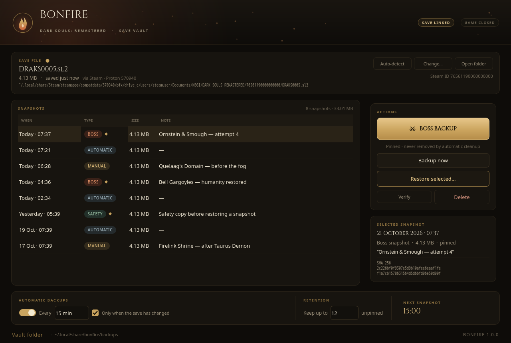
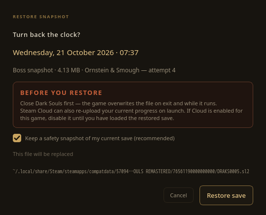

# Bonfire

A save vault for **Dark Souls: Remastered** — automatic snapshots, one-click
boss backups, and timestamp-based restore that will not let you lose the run
you are on.



## What it does

- **Finds the save itself.** Reads Steam's `libraryfolders.vdf`, follows every
  Proton prefix for app `570940`, and also checks plain Wine/Bottles prefixes,
  Windows Documents (including OneDrive-redirected folders) and extra Steam
  libraries. Manual override is there when you need it.
- **Backs up on a fixed interval.** Choose any interval from 1 minute to 24
  hours; Bonfire counts down and snapshots while it is open. It can skip
  intervals where the save has not changed, so the vault stays meaningful.
- **Boss Backup in one click.** The big gold button (or `Ctrl+B`) takes a
  snapshot and *pins* it. Pinned snapshots are never removed by retention.
- **Restores by timestamp.** Every snapshot is listed with its local time,
  type, size and note. Restore verifies the checksum and first takes a pinned
  safety snapshot of the save you are about to replace.
- **Keeps a bounded vault.** Set how many unpinned snapshots to keep; the
  oldest rotate out. Pinned boss/safety snapshots are kept until you delete
  them yourself.
- **Blocks unsafe restores.** If `DarkSoulsRemastered.exe` is running, restore
  is locked. A mid-write capture is rejected rather than silently storing a
  torn save.

## Quick start

```bash
cd ~/Desktop/dsr-save-vault
./run.sh
```

The first run uses the bundled `.venv`. If it is missing, `run.sh` creates it
and installs PySide6.

Bonfire is launched from this folder; it does not add an application-menu
entry. Keep it open while playing — the interval scheduler runs inside the
app.

## Where the save lives

| Platform | Save file |
|---|---|
| Windows | `%USERPROFILE%\Documents\NBGI\DARK SOULS REMASTERED\<SteamID>\DRAKS0005.sl2` |
| Linux (Proton) | `<Steam>/steamapps/compatdata/570940/pfx/drive_c/users/steamuser/Documents/NBGI/DARK SOULS REMASTERED/<SteamID>/DRAKS0005.sl2` |

The save card shows the exact path Bonfire linked, how it was found, and the
Steam ID folder. If the file does not exist yet (the game creates it on the
first save), Bonfire keeps looking and links it when it appears.

## Using it

| Action | How |
|---|---|
| Boss / pre-fight snapshot | **⚔ Boss Backup** or `Ctrl+B` — pinned |
| Ordinary snapshot | **Backup now** or `Ctrl+N` |
| Restore | Select a row → **Restore selected…** (or double-click) |
| Edit a note | Right-click a row → **Edit note…** |
| Verify bytes | Right-click → **Verify integrity**, or **Verify** |
| Delete | Right-click → **Delete snapshot**, or `Delete` |
| Re-run detection | **Auto-detect** or `F5` |
| Pick a save manually | **Change…** or `Ctrl+O` |

Snapshots are stored as ordinary folders under
`~/.local/share/bonfire/backups/<id>/` (`DRAKS0005.sl2` + `meta.json`).
Settings live in `~/.config/bonfire/config.json`; a log is kept at
`~/.local/share/bonfire/bonfire.log`.

On screens shorter than 860 px the selected-snapshot detail card collapses
automatically so the action buttons stay usable; the table still shows the
timestamp, type, size and note for every snapshot.

## Restore safety



1. Bonfire refuses to restore while the game process is running.
2. The selected snapshot's SHA-256 is re-checked before anything is written.
3. The current save is copied to a **pinned** `pre-restore` snapshot first.
4. The new file is written beside the target and atomically replaces it, then
   read back and verified.

**Steam Cloud:** if Cloud is enabled for Dark Souls: Remastered, launch can
re-upload the pre-restore save and undo your restore. The confirmation dialog
warns about this. Disable Cloud for the game until you have loaded the restored
save, then re-enable it.

## Command line

Useful for scripting or a quick snapshot without opening the window:

```bash
./run.sh detect
./run.sh backup --kind boss --note "Ornstein & Smough"
./run.sh list
./run.sh restore latest --yes
./run.sh prune --keep 20
```

`restore` also takes a snapshot id from `list`.

## Retention semantics

- `Keep up to N unpinned` — the N newest automatic/manual (unpinned)
  snapshots survive; older ones are removed after each backup.
- **Boss** and **pre-restore** snapshots are pinned by default and are never
  auto-removed, even if that means the vault holds more than N.
- Deleting a pinned snapshot is allowed, with an explicit warning.

## Development

```bash
./.venv/bin/python -m unittest discover -s tests
```

17 tests cover detection (fake Steam libraries, Proton, Wine), metadata and
rotation, byte-identical restore, corruption detection, config persistence,
and a headless Qt smoke test that exercises the buttons and table.

The app is built with PySide6 (`PySide6-Essentials`), no other runtime
dependencies. Tested on Arch Linux with Python 3.14 / PySide6 6.12 against the
real Proton prefix for app `570940`. Windows and Wine paths are implemented
but were not exercised on Windows hardware here.

On Windows, run `python -m pip install -r requirements.txt` and then
`python -m bonfire` from the project folder (`run.sh` is Linux/macOS only).

Bonfire is an unofficial fan tool. It is not affiliated with FromSoftware or
Bandai Namco. It never uploads your saves anywhere.

## Layout

```
bonfire/
  detect.py        save discovery: Steam VDF, Proton, Wine, Documents
  store.py         vault format, SHA-256, rotation, atomic restore
  config.py        settings JSON
  system.py        game-process check, BND4 validation, file manager
  cli.py           detect / backup / list / restore / prune
  ui/              theme, custom widgets, main window
assets/            icon, Cinzel font (SIL OFL), screenshots
tests/             unit + headless UI tests
```
